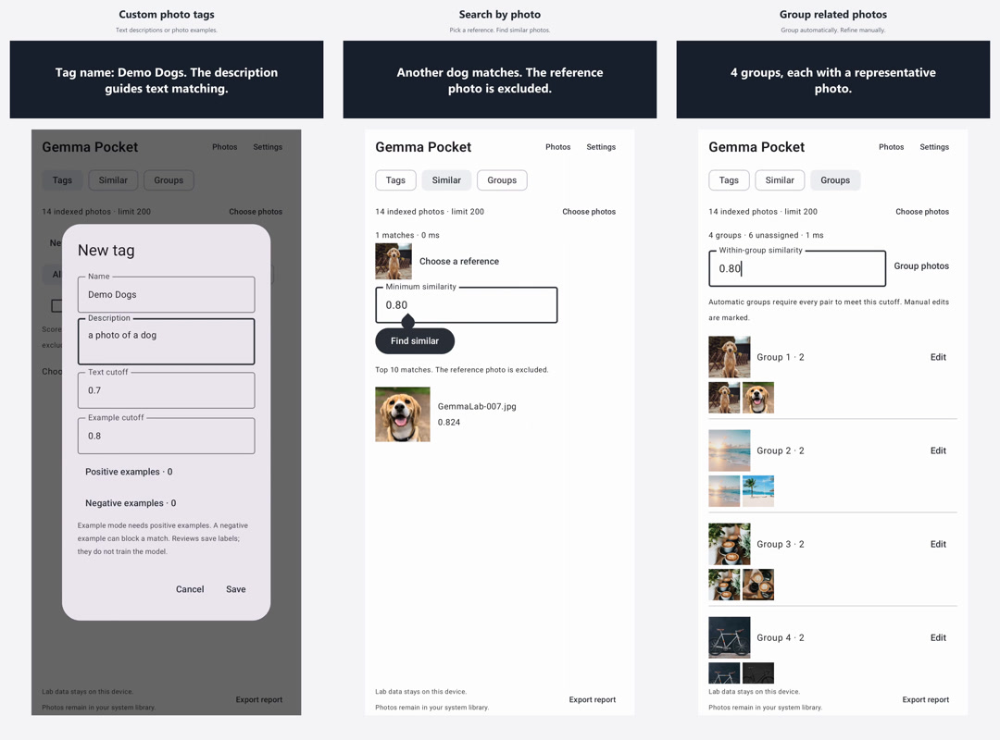

# Gemma Gallery

On-device photo search and organization for Android and iOS, built with Kotlin Multiplatform and [EmbeddingGemma 2 Text-Vision 440M](https://huggingface.co/litert-community/embeddinggemma-2-text-vision-440m-litert-lm).

Connect your system photo library, index photos locally, and search by image content. The Compose UI and experiment logic are shared; Android uses MediaStore and iOS uses PhotoKit.



## What it does

- **Text search:** find indexed photos with a description. Results below the similarity cutoff are hidden.
- **Custom tags:** define a category with text or positive/negative photo examples, then confirm or reject suggestions. Confirmations save labels locally; they do not train the model.
- **Search by photo:** find up to ten similar photos, excluding the reference itself.
- **Groups:** cluster related photos, then rename, split, move or merge the local groups.
- **System photos:** browse, select, share and organize the library through native photo APIs and system consent.

Lab runs use up to 200 selected, indexed photos. The main library has no 200-photo cap. Tags and Lab groups are app-local metadata; they do not create system albums. See [Lab details](docs/lab.md).

## Demos

| Feature | Video | Length |
| --- | --- | --- |
| Custom tags | [Watch](docs/media/tags-2x.mp4) | 50 s |
| Search by photo | [Watch](docs/media/similar-2x.mp4) | 30 s |
| Grouping and edits | [Watch](docs/media/groups-2x.mp4) | 41 s |

These MuMu recordings run at **2× playback speed**, with English subtitles and click indicators. They use 14 pre-indexed public test photos. They demonstrate the features; they do not measure first-scan or physical-phone performance. [Media sources and licenses](docs/media/README.md).

## Build Android

Install **JDK 21**, Python 3.11+, and **Android SDK Platform 36 / Build Tools 36.0.0**. Set `JAVA_HOME` and `ANDROID_HOME`, or let Android Studio create an ignored `local.properties` with your SDK path. The Gradle wrapper downloads the pinned Gradle distribution automatically.

```sh
git clone https://github.com/leconio/gemma-gallery.git
cd gemma-gallery
./gradlew :app:assembleDebug
```

On Windows PowerShell, use `./gradlew.bat` in place of `./gradlew`.

The default APK targets **arm64-v8a** phones and is written to `app/build/outputs/apk/debug/app-debug.apk`. Android 9+ is required; Android 11+ is required for trash and folder moves. Install it on a device you explicitly choose:

```sh
adb devices -l
adb -s '<device-serial>' install -r app/build/outputs/apk/debug/app-debug.apk
```

For an x86_64 emulator such as MuMu:

```sh
./gradlew -Pgemma.emulator=true :app:assembleDebug :app:assembleDebugAndroidTest
```

Open the app, download the model, then choose **Connect Photos**. Grant access to the photos you want to index and start scanning. Photo inference is serialized; increasing CPU threads is different from running multiple image inferences concurrently.

## Build iOS

Use a Mac with Xcode, its command-line tools, JDK 21 and Python 3.11+. The deployment target is **iOS 16+**. From the repository root:

```sh
python3 scripts/build_ios.py
```

This builds an unsigned arm64 iOS Simulator app at `iosApp/build/simulator/Build/Products/Debug-iphonesimulator/GemmaPocket.app`. It also generates `iosApp/build/project/GemmaPocket.xcodeproj` for inspection in Xcode. No Apple account is needed for the unsigned simulator build.

```sh
python3 scripts/build_ios.py --device
```

The device command compiles an unsigned arm64 iPhone app. Installing on a physical iPhone requires your own signing configuration. Generated projects, downloaded SDK files and signing material are excluded from Git. The official LiteRT-LM Swift sources and binary are pinned in [sdk-lock.json](iosApp/sdk-lock.json).

Android Lab flows have been exercised on MuMu with the real model. iOS build checks and earlier system-photo acceptance are separate; the Lab flows still need physical-iPhone validation.

## Model and local data

The model is a separate **387,710,976-byte download** (about 388 MB / 370 MiB), verified against a pinned SHA-256. It downloads once per app installation, with pause/resume support, and is checked again on later launches. After download, indexing and search run locally. The model is not bundled in the APK or Git repository. See [model-manifest.json](model-manifest.json).

Photo search uses normalized **768-dimensional Float32 vectors**: 3,072 bytes per photo before SQLite metadata and thumbnail caches. The app uses exact cosine ranking. Scores are similarities, not probabilities; the starting search cutoff of 0.68 needs validation against your own collection. [Relevance measurements and known errors](docs/search-relevance.md).

Scanning runs in the foreground and saves progress after each photo. Pause finishes the current inference. Search covers the indexed portion of the library. There is no scheduled background scan, duplicate detector or automatic cleanup policy in this version.

On Android 11+, moving a photo to another folder changes its file location. iOS album organization changes membership without moving or duplicating assets; full Photos access is required for album organization. Deletion uses system consent. Test management actions on disposable photos first.

Photos, queries, vectors, tags and groups are processed locally. Model downloads contact Hugging Face or the configured checksum-matched mirror. Sharing photos or exporting a Lab report uses the system share sheet. Reports omit pixels and vectors but can contain filenames, photo IDs, tags and descriptions. [Privacy and storage details](docs/privacy.md).

## Development

The shared module contains Compose UI, scanning coordination, vector validation, ranking, tagging and clustering. Native adapters handle photo permissions, photo changes, SQLite and [LiteRT-LM 0.18.0](https://github.com/google-ai-edge/LiteRT-LM/tree/v0.18.0) inference.

```sh
./gradlew :shared:jvmTest :app:lintDebug :app:assembleDebugAndroidTest
python3 scripts/test_downloader.py
./gradlew :app:assembleRelease
python3 scripts/check_release_apk.py app/build/outputs/apk/release/app-release-unsigned.apk
```

Unit and downloader tests do not need model weights, personal photos or a connected device. The release check verifies license notices and rejects bundled model weights, debug fixtures and the debug benchmark activity. The unsigned release APK needs a signing key before distribution.

GitHub Actions runs the Android build/tests, an unsigned iOS simulator build, Gradle wrapper validation and secret scanning. Device UI tests remain explicit opt-in tasks. See [contributing](CONTRIBUTING.md), [benchmark methodology](docs/samsung-benchmark.md) and [release preparation](docs/releasing.md).

## License

Project code is licensed under [Apache-2.0](LICENSE). Model weights, dependencies, photos and media retain their upstream licenses; see [third-party notices](THIRD_PARTY_NOTICES.md) and [NOTICE](NOTICE). Gemma Gallery is an independent demo built with Google's model and runtime.
